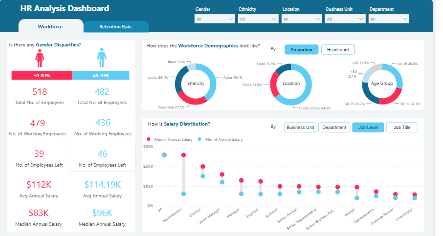
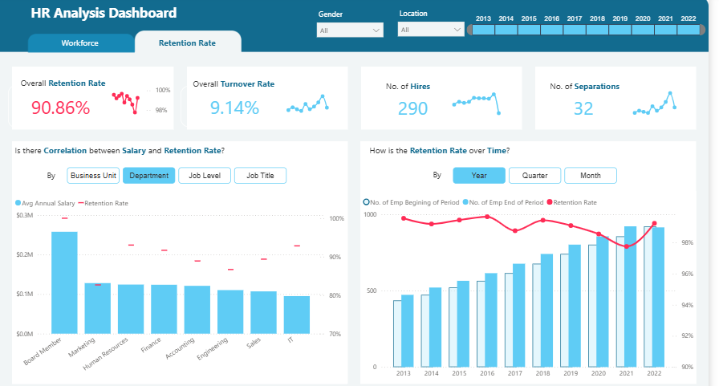

# 👥 HR Analysis Dashboard — Power BI

An interactive **Power BI HR Analytics Dashboard** designed to analyze workforce demographics, salary distribution, employee retention, turnover, hiring, separations, and workforce trends.

This project transforms employee data into meaningful HR insights using **Microsoft Power BI, Power Query, DAX, Microsoft Excel, data modeling, and interactive data visualization**.

---

## 📊 Dashboard Overview

The HR Analysis Dashboard consists of two main analytical views:

### 1. Workforce Analysis

The Workforce dashboard provides an overview of the employee population and analyzes:

- Gender distribution
- Ethnicity distribution
- Employee locations
- Business units
- Departments
- Age groups
- Salary distribution
- Job levels
- Job titles
- Workforce composition
- Employee status

### 2. Retention Rate Analysis

The Retention Rate dashboard focuses on employee retention and workforce movement, including:

- Overall retention rate
- Overall turnover rate
- Number of hires
- Number of separations
- Salary and retention relationship
- Retention trends over time
- Business unit analysis
- Department analysis
- Job level analysis
- Job title analysis

---

## 🖼️ Dashboard Preview

### 👥 Workforce Dashboard



The Workforce dashboard provides an interactive view of employee demographics, workforce distribution, salary levels, job roles, and employee status.

---

### 📈 Retention Rate Dashboard



The Retention Rate dashboard analyzes employee retention, turnover, hiring, separations, salary correlation, and retention trends across different time periods and organizational segments.

---

## 🎯 Project Objectives

The main objectives of this project are to:

- Analyze workforce demographics
- Understand employee distribution across departments and business units
- Compare workforce composition by gender and ethnicity
- Analyze employee salary distribution
- Monitor employee retention
- Analyze employee turnover
- Track hiring and separation trends
- Understand retention patterns over time
- Compare retention across organizational segments
- Build an interactive HR Business Intelligence solution

---

## 📈 Key HR Metrics

| Metric | Value |
|---|---:|
| 👥 Total Employees | 1,000 |
| 👩 Female Employees | 518 |
| 👨 Male Employees | 482 |
| 💼 Working Female Employees | 479 |
| 💼 Working Male Employees | 436 |
| 🚪 Female Employees Left | 39 |
| 🚪 Male Employees Left | 46 |
| 📊 Overall Retention Rate | 90.86% |
| 🔄 Overall Turnover Rate | 9.14% |
| 🆕 Total Hires | 290 |
| 🚪 Total Separations | 32 |

---

## 💰 Salary Analysis

The dashboard analyzes salary distribution across different organizational dimensions.

Salary analysis includes:

- Average annual salary
- Median annual salary
- Business unit
- Department
- Job level
- Job title
- Salary range comparison

### Workforce Salary Snapshot

| Category | Average Annual Salary | Median Annual Salary |
|---|---:|---:|
| Female | $112K | $83K |
| Male | $114.19K | $96K |

The dashboard allows salary distribution to be explored interactively using business unit, department, job level, and job title filters.

---

## 🌍 Workforce Demographics

The dashboard provides demographic analysis across multiple dimensions.

### Gender

The workforce includes:

- **51.80% Female**
- **48.20% Male**

### Ethnicity

The dashboard analyzes workforce representation across different ethnic groups.

### Location

Employee distribution is analyzed across locations, providing insights into the geographical composition of the workforce.

### Age Group

Employee demographics are also analyzed across different age groups.

---

## 🏢 Organizational Analysis

The dashboard provides interactive analysis across:

- Business Units
- Departments
- Job Levels
- Job Titles

This enables HR teams to explore workforce and retention patterns across different organizational segments.

---

## 🔄 Employee Retention Analysis

The Retention Rate dashboard provides detailed workforce movement analysis.

### Overall Retention Rate

**90.86%**

### Overall Turnover Rate

**9.14%**

These KPIs provide a high-level view of employee retention and workforce movement.

---

## 🆕 Hiring & Separation Analysis

The dashboard tracks employee movement using:

- Number of Hires
- Number of Separations
- Employee retention
- Employee turnover
- Workforce changes over time

### Current Dashboard Metrics

**Total Hires:** 290

**Total Separations:** 32

---

## 📅 Retention Trend Analysis

The dashboard analyzes retention trends over time using:

- Year
- Quarter
- Month

The time-based analysis helps identify changes in employee retention and workforce size over different periods.

The dashboard currently provides yearly analysis covering **2013–2022**.

---

## 💰 Salary & Retention Relationship

The project analyzes the relationship between employee salary and retention rate.

The analysis can be explored by:

- Business Unit
- Department
- Job Level
- Job Title

This provides a way to compare salary levels with retention patterns across different organizational segments.

---

## 🎛️ Interactive Filters

The dashboard includes interactive filters such as:

- Gender
- Ethnicity
- Location
- Business Unit
- Department
- Year
- Quarter
- Month
- Job Level
- Job Title

These filters allow users to perform focused HR analysis without modifying the underlying dataset.

---

## 🛠️ Tools & Technologies

| Tool / Technology | Purpose |
|---|---|
| 🟦 Microsoft Power BI | Dashboard development and visualization |
| 🟨 Power Query | Data cleaning and transformation |
| 📐 DAX | Measures, KPIs and analytical calculations |
| 📊 Microsoft Excel | Source datasets and data preparation |
| 🧠 Data Modeling | Organizing relationships between datasets |
| 📈 Data Visualization | Interactive HR reporting |
| 💼 HR Analytics | Workforce and retention analysis |

---

## 🧠 Skills Demonstrated

### Power BI

- Dashboard Development
- Interactive Reports
- KPI Development
- Data Visualization
- Drill-down Analysis
- Interactive Filtering
- Business Intelligence

### Power Query

- Data Cleaning
- Data Transformation
- Data Preparation
- Data Shaping

### DAX

- Measure Creation
- KPI Calculations
- Aggregations
- Retention Rate Calculations
- Turnover Analysis
- Salary Analysis

### HR Analytics

- Workforce Analysis
- Employee Demographics
- Salary Analysis
- Retention Analysis
- Turnover Analysis
- Hiring Analysis
- Separation Analysis
- Workforce Trend Analysis

---

## 🔄 Project Workflow

```text
Raw HR Data
     ↓
Data Cleaning
     ↓
Data Transformation
     ↓
Power Query
     ↓
Data Modeling
     ↓
DAX Measures
     ↓
HR Analytics
     ↓
Interactive Visualizations
     ↓
Power BI Dashboard
     ↓
Business Insights
```

---

## 📂 Project Structure

```text
HR-Analysis-Dashboard-PowerBI/
│
├── Images/
│   ├── HR_Workforce_Dashboard.png
│   └── HR_Retention_Dashboard.png
│
├── Power BI Dashboard File
│
├── DIM_Date.xlsx
├── FACT_Employees.xlsx
├── Job_Level.xlsx
├── Parameter.xlsx
├── Y_Q_M.xlsx
│
└── README.md
```

---

## 🚀 How to Use

### Step 1 — Install Power BI

Install **Microsoft Power BI Desktop**.

### Step 2 — Open the Dashboard

Open the Power BI dashboard file included in this repository.

### Step 3 — Refresh Data

If required, refresh the connected Excel datasets.

### Step 4 — Explore the Dashboard

Use the available filters and report pages to analyze:

- Workforce demographics
- Gender distribution
- Ethnicity
- Locations
- Salary distribution
- Departments
- Business units
- Job levels
- Retention
- Turnover
- Hiring
- Separations
- Retention trends

---

## 📌 Business Insights Supported

This dashboard can help HR analysts explore questions such as:

- What does the current workforce composition look like?
- How is the workforce distributed by gender and ethnicity?
- Which locations have the highest employee representation?
- How does salary vary across job levels and departments?
- What is the overall employee retention rate?
- What is the overall turnover rate?
- How many employees were hired?
- How many employees separated from the organization?
- How has retention changed over time?
- How does salary relate to retention across organizational segments?

---

## 🎓 Learning Outcomes

This project demonstrates practical experience in:

- Building professional Power BI dashboards
- Performing HR data analysis
- Cleaning and transforming datasets
- Creating DAX measures
- Developing HR KPIs
- Creating interactive visualizations
- Analyzing workforce demographics
- Performing salary analysis
- Analyzing employee retention
- Analyzing employee turnover
- Tracking hiring and separations
- Building business intelligence reports
- Presenting data-driven insights

---

## ⭐ Project Highlight

The **HR Analysis Dashboard** demonstrates how employee data can be transformed into an interactive Business Intelligence solution using **Power BI, Power Query, DAX, Excel, and data visualization**.

The dashboard combines workforce demographics, salary analysis, retention metrics, turnover analysis, hiring, separations, and time-based trends into a unified HR analytics solution.

---

## 👨‍💻 Author

**Deep Gaikwad**

**Aspiring Data Analyst**

`Excel` | `SQL` | `Python` | `Power BI` | `DAX` | `Power Query` | `Data Analysis` | `Data Visualization`

---

## 📊 Project Category

**HR Analytics | Data Analytics | Business Intelligence | Power BI | Data Visualization**

---

⭐ If you find this project useful, consider giving the repository a star.